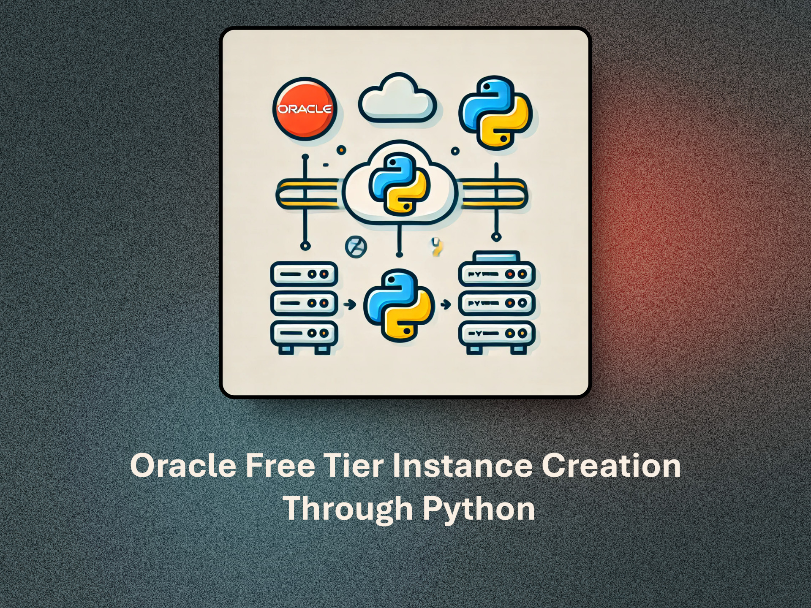

<h1 align="center">
  <br/>
  Oracle Free Tier Instance Creation
</h1>

<p align="center">
  <b>Automate the provisioning of Oracle Cloud Always-Free ARM &amp; AMD instances.</b><br/>
  A resilient Python worker that retries until capacity frees up — so you don't have to keep clicking.
</p>

<p align="center">
  <a href="#features"></a>
  <a href="#quick-start"></a>
  <a href="https://github.com/stymrj/oracle-free-tier-instance-creation/issues"></a>
</p>

<p align="center">
  <a href="https://www.python.org/"></a>
  <a href="https://www.gnu.org/software/bash/"></a>
  <a href="https://www.oracle.com/cloud/"></a>
  <a href="LICENSE"></a>
  <a href="https://github.com/stymrj/oracle-free-tier-instance-creation"></a>
  <a href="https://github.com/stymrj/oracle-free-tier-instance-creation/network/members"></a>
  <a href="#contributing"></a>
</p>

---

## 📖 Table of Contents

<details>
<summary><b>Click to expand</b></summary>

- [✨ Features](#-features)
- [🎯 Why This Exists](#-why-this-exists)
- [⚙️ How It Works](#️-how-it-works)
- [📋 Pre-Requisites](#-pre-requisites)
- [🚀 Quick Start](#-quick-start)
- [🛠️ Detailed Setup](#️-detailed-setup)
- [🔧 Environment Variables](#-environment-variables)
- [💻 Run](#-run)
- [⚠️ Errors & Re-Run](#️-errors--re-run)
- [📢 Notifications](#-notifications)
- [📊 Instance Creation Flow](#-instance-creation-flow)
- [🗺️ Roadmap](#️-roadmap)
- [❓ FAQ](#-faq)
- [🤝 Contributing](#-contributing)
- [👤 Author](#-author)
- [📄 License](#-license)
- [🔗 Credits & References](#-credits--references)

</details>

---

## ✨ Features

| | | |
|:---:|:---|:---|
| 🖥️ **ARM & AMD** | Provision `VM.Standard.A1.Flex` (ARM) or `VM.Standard.E2.1.Micro` (AMD) Always-Free instances |
| 🔁 **Auto-Retry** | Polls the `LaunchInstance` API and retries on `Out of host capacity` until a slot opens |
| 🔑 **SSH Auto-Gen** | Generates an RSA key pair automatically if none exists at the configured path |
| 🌍 **AD Rotation** | Rotates across multiple availability domains on each retry for better odds |
| 📧 **Gmail Alerts** | Success & failure notifications straight to your inbox |
| 💬 **Discord** | Webhook notifications for your server/channel |
| 📱 **Telegram** | Bot notifications with token & user ID |
| 🛠️ **Zero-Friction Setup** | Interactive `setup_env.sh` + `setup_init.sh` for one-command install & run |
| 📊 **Observability** | Structured logs + a Mermaid flow diagram of the whole process |

---

## 🎯 Why This Exists

Oracle's **Always Free tier** offers powerful ARM compute — but the catch is real: **"Out of host capacity"** errors are constant. Free ARM hosts are in such high demand that clicking "Create" in the console is a losing game. Capacity frees up unpredictably, in small windows, and whoever polls at that exact second wins.

This project is that poller. It:

1. Hammers the launch API on a **polite interval** (default 60s).
2. Recognizes the "no capacity, try again" family of errors.
3. Grabs the slot **the instant one opens**.
4. Notifies you on success — no manual babysitting.

> **Note (June 2026):** Oracle reduced the Always-Free Ampere A1 allowance from **4 OCPU / 24 GB RAM** to **2 OCPU / 12 GB RAM** (1,500 OCPU-hours + 9,000 GB-hours/month). Verify your tenancy's actual limits in **Billing → Cost Analysis** before configuring.

---

## ⚙️ How It Works

The script attempts to create an instance every 60 seconds (or per `REQUEST_WAIT_TIME_SECS`) until it succeeds. On completion, it writes an `INSTANCE_CREATED` file with the instance details and (optionally) sends a notification.

```
loop:
  LaunchInstance  shape=VM.Standard.A1.Flex ...
  ├─ success              → write INSTANCE_CREATED, notify, exit 0
  ├─ hard failure (4xx)   → print error, notify, stop (fix config)
  │   e.g. auth failure / bad OCID / LimitExceeded
  └─ transient error      → wait REQUEST_WAIT_TIME_SECS, rotate AD, retry
      e.g. "Out of host capacity" / 429 / 5xx / timeout / network blip
```

The error handling is the important part: it **stops immediately on real problems** (bad OCID, auth failure, quota exceeded) instead of looping forever against a wall — and **keeps retrying on everything else**, so an unfamiliar transient error can't silently kill a multi-day hunt.

---

## 📋 Pre-Requisites

- **`VM.Standard.E2.1.Micro` Instance**: The script is designed for an Ubuntu environment. Create an always-free Micro instance (Ubuntu 22.04) — you need an existing subnet for ARM creation. This Micro instance can be deleted after the ARM instance is created. *(Not required if an existing `OCI_SUBNET_ID` is set in `oci.env`.)*
- **OCI API Key & Config Details**: Follow the [Oracle API Key Generation guide](https://graph.org/Oracle-API-Key-Generation-12-11) to create the key pair and config.
  - *Tip:* API keys are generated from your [profile page](https://cloud.oracle.com/identity/domains/my-profile/api-keys) → **API Keys** (left) → **Add API Key**.
- **OCI Free Availability Domain**: Identify the eligibility always-free availability domain during instance creation.
- **Gmail App Passkey *(optional)***: For email notifications with 2FA enabled, follow the [Google App Password guide](https://graph.org/Google-App-Passwords-Generation-12-11).

### 🔐 Required Keys & OCIDs

Per [Oracle's docs](https://docs.oracle.com/en-us/iaas/Content/API/Concepts/apisigningkey.htm):

1. An IAM user in a group with `manage` permissions on instances & VNICs
2. An RSA key pair in **PEM format** (min 2048 bits)
3. The **fingerprint** of the public key
4. Your **tenancy OCID** and **user OCID**

> ⚠️ **Never commit your private key.** OCI actively detects leaked keys in public repos and will flag your tenancy.

---

## 🚀 Quick Start

```bash
# 1. Clone
git clone https://github.com/stymrj/oracle-free-tier-instance-creation.git
cd oracle-free-tier-instance-creation

# 2. Configure OCI API credentials
cp sample_oci_config oci_config
#   → edit oci_config with your user/fingerprint/tenancy/key_file

# 3. Generate your environment config (interactive)
chmod +x setup_env.sh setup_init.sh
./setup_env.sh

# 4. Install dependencies & launch the retry loop
./setup_init.sh
```

---

## 🛠️ Detailed Setup

1. **SSH into your Micro instance**, clone the repo, and navigate into it:
   ```bash
   git clone https://github.com/stymrj/oracle-free-tier-instance-creation.git
   cd oracle-free-tier-instance-creation
   ```

2. **Create `oci_api_private_key.pem`** and paste your API private key contents. The name and path can be anything, but the current user must have read access.

3. **Create `oci_config`** in the repo directory and paste the config details you copied during API key creation. See [`sample_oci_config`](sample_oci_config).

4. In `oci_config`, set **`key_file`** to the absolute path of your private key:
   ```ini
   key_file=/home/ubuntu/oracle-free-tier-instance-creation/oci_api_private_key.pem
   ```

5. **Configure `oci.env`** — either manually (copy `oci.env.sample`) or interactively:
   ```bash
   ./setup_env.sh
   ```
   This walks you through instance name, compute shape, availability domain, Gmail notifications, and more.

   > **Note:** If `oci.env` already exists, the script backs it up as `oci.env.bak`.

---

## 🔧 Environment Variables

### Required Fields

| Variable | Description |
|----------|-------------|
| `OCI_CONFIG` | Absolute path to the file with OCI API config details |
| `OCT_FREE_AD` | Availability domain eligible for the **Always-Free tier**. Separate multiple by commas — the script **rotates** through them on each retry (not in parallel) |

### Optional Fields

| Variable | Description |
|----------|-------------|
| `DISPLAY_NAME` | Name of the instance |
| `REQUEST_WAIT_TIME_SECS` | Wait time (seconds) before trying to launch again |
| `SSH_AUTHORIZED_KEYS_FILE` | Absolute path of an SSH public key for the ARM instance. **A key pair is auto-generated at this path if it doesn't exist; otherwise the existing key is used.** |
| `OCI_SUBNET_ID` | OCID of an existing subnet. **Required when running locally** (not on a Micro instance). Leave empty on a Micro instance — the subnet is auto-detected. Leaving it empty while running locally may pick an unexpected subnet.<br/>👉 *Found at `Networking` → `Virtual cloud networks` → `<VPC-Name>` → `Subnet Details`.* |
| `OCI_IMAGE_ID` | Specific image OCID. If empty, `OPERATING_SYSTEM` + `OS_VERSION` are used to find the newest match. The first run writes all options to `images_list.json` — check it for valid image OCIDs. |
| `OCI_COMPUTE_SHAPE` | Free-tier compute shape. Defaults to ARM. Accepts `VM.Standard.A1.Flex` or `VM.Standard.E2.1.Micro`. |
| `SECOND_MICRO_INSTANCE` | Set `True` only when creating your **second** Always-Free Micro instance. Keep `False` for your first Micro or any ARM instance. |
| `OPERATING_SYSTEM` | Exact OS name |
| `OS_VERSION` | Exact OS version |
| `ASSIGN_PUBLIC_IP` | Automatically assign an ephemeral public IP |
| `BOOT_VOLUME_SIZE` | Boot volume size in GB (values below 50 are ignored, defaults to 50) |
| `NOTIFY_EMAIL` | `True` to enable email notifications |
| `EMAIL` | Gmail only — used for both *FROM* and *TO* |
| `EMAIL_PASSWORD` | With 2FA, use an **App Password** (not your email password). Spaces are stripped automatically. |
| `DISCORD_WEBHOOK` | Discord webhook URL *(optional)* |
| `TELEGRAM_TOKEN` / `TELEGRAM_USER_ID` | Telegram bot credentials *(optional)* |

---

## 💻 Run

Once setup is complete, run from the project directory:

```bash
./setup_init.sh
```

This installs dependencies and starts the Python program in the background.

- On a **fresh Micro instance** you may see a *"Daemons using outdated libraries"* prompt — just click **OK** (it's from `apt update` and won't reappear).
- Running **locally** (not on a Micro instance)? Make sure `OCI_SUBNET_ID` is set.

The script prints an error prompt on failure, or **"Script is running successfully"** when healthy.

### 📜 Logs

| File | Contents |
|------|----------|
| `launch_instance.log` | Live API call results |
| `setup_and_info.log` | Resolved params (AD, compartment, subnet, image) |
| `UNHANDLED_ERROR.log` | Unhandled exceptions (also emailed) |
| `INSTANCE_CREATED` | Instance details once created |

---

## ⚠️ Errors & Re-Run

- **Wrong `oci_config`?** The script writes `ERROR_IN_CONFIG.log`. Verify `oci_config` matches [`sample_oci_config`](sample_oci_config) exactly — no extra lines or characters.
- **Unhandled exception?** An email is sent (if opted); otherwise the error is logged to `UNHANDLED_ERROR.log`. Review it and re-run (skips dependency install):
  ```bash
  ./setup_init.sh rerun
  ```
  If the issue persists, open an issue with the contents of `UNHANDLED_ERROR.log`.

---

## 📢 Notifications

### 📧 Gmail
```bash
NOTIFY_EMAIL=True
EMAIL=you@gmail.com
EMAIL_PASSWORD=your16charapppassword   # spaces stripped automatically
```

### 💬 Discord Webhook
1. In Discord: **Server Settings → Integrations → Webhooks**
2. Click **"New Webhook"** and pick the target channel
3. Copy the webhook URL
4. Add to `oci.env`:
   ```
   DISCORD_WEBHOOK=your_discord_webhook_url_here
   ```

### 📱 Telegram
**1. Create a bot**
1. Open Telegram, search `@BotFather`, start a chat
2. Send `/newbot`, follow prompts (username must end in `bot`)
3. Copy the **Bot Token**

**2. Get your User ID**
1. Search `@myidbot`, send any message
2. Note the returned **User ID**

**3. Configure `oci.env`**
```bash
TELEGRAM_TOKEN=your_telegram_bot_token_here
TELEGRAM_USER_ID=your_telegram_user_id_here
```

---

## 📊 Instance Creation Flow


---

## 🗺️ Roadmap

- [x] Configure existing subnet ID in `OCI_CONFIG` for local runs
- [x] Redirect logs to a Telegram bot
- [ ] Create VPC & subnet from the script when running locally
- [ ] Make boot volume size configurable with free-tier limit handling
- [ ] Assign a public IP through the script with limit handling
- [ ] Interactive image/OS picker before launch
- [ ] Docker image for zero-dependency runs

---

## ❓ FAQ

**Is the script actually working? The log shows "Out of host capacity" errors.**

Yes — completely normal. `Out of host capacity` (or `InternalError: Out of host capacity`) means Oracle has no free capacity right now. The script keeps retrying every `REQUEST_WAIT_TIME_SECS` seconds until capacity opens. As long as you see these lines in `launch_instance.log`, it's running correctly.

**How do I stop the script?**

Press `Ctrl+C`, or kill the PID shown at startup. If you used `screen`, re-attach with `screen -r` then `Ctrl+C`. The background PID is stored in `$SCRIPT_PID` while `setup_init.sh` is running.

**How do I change how often it retries?**

Set `REQUEST_WAIT_TIME_SECS` in `oci.env` (default 60s). Setting it too low (e.g. < 30s) risks OCI rate-limiting (`TooManyRequests`).

**I see a `LimitExceeded` error — do I already have an instance?**

Not necessarily. It means you hit a service limit. Log into the [OCI Console](https://cloud.oracle.com) and check whether an ARM instance already exists (the script should detect it and exit). If not, the limit may be boot-volume storage.

**For more error-specific help, see [TROUBLESHOOTING.md](TROUBLESHOOTING.md).**

---

## 🤝 Contributing

Contributions make this project better — all are welcome! 🎉

1. **Fork** the repository
2. **Branch** — `git checkout -b feat/amazing-feature`
3. **Commit** — `git commit -m "Add amazing feature"`
4. **Push** — `git push origin feat/amazing-feature`
5. **PR** — open a pull request

---

## 👤 Author

<table>
<tr>
<td align="center">
  <a href="https://github.com/stymrj">
    
    <br/>
    <b>Satyam Raj</b>
  </a>
  <br/>
  <sub>Maintainer</sub>
</td>
</tr>
</table>

---

## 📄 License

Distributed under the **MIT License**. See [LICENSE](LICENSE) for more information.

---

## 🔗 Credits & References

- [xitroff](https://www.reddit.com/user/xitroff/) — [Resolving Oracle Cloud Out of Capacity Issue and Getting Free VPS with 4 ARM Cores, 24GB of RAM](https://hitrov.medium.com/resolving-oracle-cloud-out-of-capacity-issue-and-getting-free-vps-with-4-arm-cores-24gb-of-a3d7e6a027a8) / [oci-arm-host-capacity](https://github.com/hitrov/oci-arm-host-capacity)
- [Oracle Launch Instance Docs](https://docs.oracle.com/en-us/iaas/api/#/en/iaas/20160918/Instance/LaunchInstance)
- [LaunchInstanceDetails](https://docs.oracle.com/en-us/iaas/api/#/en/iaas/20160918/datatypes/LaunchInstanceDetails)
- [OCI Python SDK — Launch Instance Example](https://docs.oracle.com/en-us/iaas/tools/python-sdk-examples/latest/core/launch_instance.py.html)
- [OCI SDK Authentication Methods](https://docs.oracle.com/en-us/iaas/Content/API/Concepts/sdk%5Fauthentication%5Fmethods.htm)
- [Required Keys & OCIDs](https://docs.oracle.com/en-us/iaas/Content/API/Concepts/apisigningkey.htm)

---

<p align="center">
  Made with ❤️ by <a href="https://github.com/stymrj">Satyam Raj</a>
</p>
