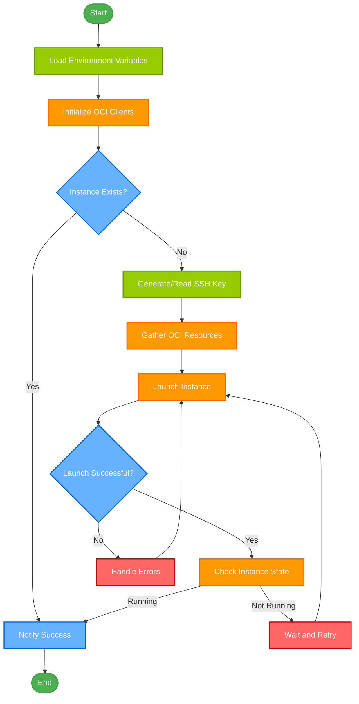

<h1 align="center">
  <br/>
  Oracle Free Tier Instance Creation
</h1>

<p align="center">
  <b>Automate the provisioning of Oracle Cloud Always-Free ARM &amp; AMD instances.</b><br/>
  A resilient Python worker that retries until capacity frees up — so you don't have to keep clicking.
</p>

<p align="center">
  <a href="#features"></a>
  <a href="#quick-start"></a>
  <a href="https://github.com/stymrj/oracle-free-tier-instance-creation/issues"></a>
</p>

<p align="center">
  <a href="https://www.python.org/"></a>
  <a href="https://www.gnu.org/software/bash/"></a>
  <a href="https://www.oracle.com/cloud/"></a>
  <a href="LICENSE"></a>
  <a href="https://github.com/stymrj/oracle-free-tier-instance-creation"></a>
  <a href="https://github.com/stymrj/oracle-free-tier-instance-creation/network/members"></a>
  <a href="#contributing"></a>
</p>

---

## 📖 Table of Contents

<details>
<summary><b>Click to expand</b></summary>

- [✨ Features](#-features)
- [🎯 Why This Exists](#-why-this-exists)
- [⚙️ How It Works](#️-how-it-works)
- [📋 Prerequisites](#-prerequisites)
- [🚀 Quick Start](#-quick-start)
- [🔧 Configuration](#-configuration)
- [💻 Usage](#-usage)
- [📁 Project Structure](#-project-structure)
- [📢 Notifications](#-notifications)
- [📊 Instance Creation Flow](#-instance-creation-flow)
- [🗺️ Roadmap](#️-roadmap)
- [❓ FAQ](#-faq)
- [🤝 Contributing](#-contributing)
- [👤 Author](#-author)
- [📄 License](#-license)
- [🔗 References](#-references)

</details>

---

## ✨ Features

| | | |
|:---:|:---|:---|
| 🖥️ **ARM & AMD** | Provision `VM.Standard.A1.Flex` (ARM) or `VM.Standard.E2.1.Micro` (AMD) Always-Free instances |
| 🔁 **Auto-Retry** | Polls the `LaunchInstance` API and retries on `Out of host capacity` until a slot opens |
| 🔑 **SSH Auto-Gen** | Generates an RSA key pair automatically if none exists at the configured path |
| 🌍 **AD Rotation** | Rotates across multiple availability domains on each retry for better odds |
| 📧 **Gmail Alerts** | Success & failure notifications straight to your inbox |
| 💬 **Discord** | Webhook notifications for your server/channel |
| 📱 **Telegram** | Bot notifications with token & user ID |
| 🛠️ **Zero-Friction Setup** | Interactive `setup_env.sh` + `setup_init.sh` for one-command install & run |
| 📊 **Observability** | Structured logs + a Mermaid flow diagram of the whole process |

---

## 🎯 Why This Exists

Oracle's **Always Free tier** offers powerful ARM compute — but the catch is real: **"Out of host capacity"** errors are constant. Free ARM hosts are in such high demand that clicking "Create" in the console is a losing game. Capacity frees up unpredictably, in small windows, and whoever polls at that exact second wins.

This project is that poller. It:

1. Hammers the launch API on a **polite interval** (default 60s).
2. Recognizes the "no capacity, try again" family of errors.
3. Grabs the slot **the instant one opens**.
4. Notifies you on success — no manual babysitting.

> **Note (June 2026):** Oracle reduced the Always-Free Ampere A1 allowance from **4 OCPU / 24 GB RAM** to **2 OCPU / 12 GB RAM** (1,500 OCPU-hours + 9,000 GB-hours/month). Verify your tenancy's actual limits in **Billing → Cost Analysis** before configuring.

---

## ⚙️ How It Works

```
loop:
  LaunchInstance  shape=VM.Standard.A1.Flex ...
  ├─ success              → write INSTANCE_CREATED, notify, exit 0
  ├─ hard failure (4xx)   → print error, notify, stop (fix config)
  │   e.g. auth failure / bad OCID / LimitExceeded
  └─ transient error      → wait REQUEST_WAIT_TIME_SECS, rotate AD, retry
      e.g. "Out of host capacity" / 429 / 5xx / timeout / network blip
```

The error handling is the important part: it **stops immediately on real problems** (bad OCID, auth failure, quota exceeded) instead of looping forever against a wall — and **keeps retrying on everything else**, so an unfamiliar transient error can't silently kill a multi-day hunt.

---

## 📋 Prerequisites

| Requirement | Why |
|-------------|-----|
| [Oracle Cloud](https://www.oracle.com/cloud/free/) account | Always-Free tier eligibility |
| OCI API key pair (`.pem` + config) | Signed API requests |
| Ubuntu / Debian (or any Linux) | `bash`, `python3`, `pip3` |
| Gmail + App Password *(optional)* | Email notifications |
| Discord webhook / Telegram bot *(optional)* | Alternative notifications |

### 🔐 Required Keys & OCIDs

Per [Oracle's docs](https://docs.oracle.com/en-us/iaas/Content/API/Concepts/apisigningkey.htm), you need:

1. An IAM user in a group with `manage` permissions on instances & VNICs
2. An RSA key pair in **PEM format** (min 2048 bits)
3. The **fingerprint** of the public key
4. Your **tenancy OCID** and **user OCID**

> ⚠️ **Never commit your private key.** OCI actively detects leaked keys in public repos and will flag your tenancy.

---

## 🚀 Quick Start

```bash
# 1. Clone
git clone https://github.com/stymrj/oracle-free-tier-instance-creation.git
cd oracle-free-tier-instance-creation

# 2. Configure your OCI API credentials
cp sample_oci_config oci_config
#   → edit oci_config with your user/fingerprint/tenancy/key_file

# 3. Generate your environment config (interactive)
chmod +x setup_env.sh setup_init.sh
./setup_env.sh

# 4. Install dependencies & launch the retry loop
./setup_init.sh
```

That's it. The script now runs in the background, retrying every 60s until it lands an instance. On success you'll get a notification and an `INSTANCE_CREATED` file with the details.

---

## 🔧 Configuration

### OCI API Config (`oci_config`)

Copy `sample_oci_config` → `oci_config`:

```ini
[DEFAULT]
user=ocid1.user.oc1..xxxx
fingerprint=59:6f:12:ae:b4:31:5a:e0:d1:46:e7:2f:f1:a8:c0:f9
tenancy=ocid1.tenancy.oc1..xxxx
region=ap-hyderabad-1
key_file=/home/ubuntu/oracle-free-tier-instance-creation/oci_api_private_key.pem
```

### Environment Variables (`oci.env`)

Copy `oci.env.sample` → `oci.env`, or run `./setup_env.sh`.

| Variable | Required | Default | Description |
|----------|:---:|---------|-------------|
| `OCI_CONFIG` | ✅ | — | Absolute path to your OCI config file |
| `OCT_FREE_AD` | ✅ | — | Availability domain(s), comma-separated |
| `DISPLAY_NAME` | | `my-arm-ubuntu-instance` | Instance name in the console |
| `REQUEST_WAIT_TIME_SECS` | | `60` | Seconds between retries |
| `OCI_COMPUTE_SHAPE` | | `VM.Standard.A1.Flex` | ARM or AMD shape |
| `SECOND_MICRO_INSTANCE` | | `False` | `True` for a 2nd Micro instance |
| `SSH_AUTHORIZED_KEYS_FILE` | | `$PWD/id_rsa.pub` | SSH public key path |
| `OCI_SUBNET_ID` | | auto | Required only when running locally |
| `OCI_IMAGE_ID` | | auto | Specific image OCID |
| `OPERATING_SYSTEM` | | `Canonical Ubuntu` | Used for image discovery |
| `OS_VERSION` | | `22.04` | Used for image discovery |
| `ASSIGN_PUBLIC_IP` | | `false` | Assign ephemeral public IP |
| `BOOT_VOLUME_SIZE` | | `50` | Boot volume in GB (min 50) |
| `NOTIFY_EMAIL` | | `False` | Enable Gmail notifications |
| `EMAIL` / `EMAIL_PASSWORD` | | — | Gmail + App Password |
| `DISCORD_WEBHOOK` | | — | Discord webhook URL |
| `TELEGRAM_TOKEN` / `TELEGRAM_USER_ID` | | — | Telegram bot credentials |

---

## 💻 Usage

```bash
# Fresh run (installs dependencies + starts loop)
./setup_init.sh

# Re-run (skips dependency install, starts loop immediately)
./setup_init.sh rerun
```

### 📜 Logs

| File | Contents |
|------|----------|
| `launch_instance.log` | Live API call results |
| `setup_and_info.log` | Resolved params (AD, compartment, subnet, image) |
| `UNHANDLED_ERROR.log` | Unhandled exceptions (also emailed) |
| `INSTANCE_CREATED` | Instance details once created |

---

## 📁 Project Structure

```
oracle-free-tier-instance-creation/
├── main.py                 # Core provisioning logic
├── setup_env.sh            # Interactive oci.env generator
├── setup_init.sh           # Dependency installer & runner
├── sample_oci_config       # OCI config template
├── oci.env.sample          # Environment template
├── email_content.html      # Email notification template
├── requirements.txt        # Python dependencies
├── TROUBLESHOOTING.md      # Error reference
├── LICENSE                 # MIT
└── README.md               # You are here
```

---

## 📢 Notifications

### 📧 Gmail
```bash
NOTIFY_EMAIL=True
EMAIL=you@gmail.com
EMAIL_PASSWORD=your16charapppassword   # spaces are stripped automatically
```

### 💬 Discord
```bash
DISCORD_WEBHOOK=https://discord.com/api/webhooks/...
```

### 📱 Telegram
```bash
TELEGRAM_TOKEN=123456:ABC-DEF...
TELEGRAM_USER_ID=123456789
```

---

## 📊 Instance Creation Flow



---

## 🗺️ Roadmap

- [ ] Configurable boot volume size with free-tier limit handling
- [ ] Automatic public IP assignment through the script
- [ ] Interactive image/OS picker before launch
- [ ] Local VCN & subnet creation from the script
- [ ] Docker image for zero-dependency runs

---

## ❓ FAQ

<details>
<summary><b>Why do I keep seeing "Out of host capacity"?</b></summary>
That's normal. Oracle has no free ARM slot right now. The script retries every `REQUEST_WAIT_TIME_SECS` seconds until one opens. Just leave it running — this can take hours to days.
</details>

<details>
<summary><b>Can I run this locally instead of on a Micro instance?</b></summary>
Yes — set `OCI_SUBNET_ID` to an existing subnet OCID. Leave it empty only when running on a Micro instance (auto-detected).
</details>

<details>
<summary><b>How do I stop the script?</b></summary>
Press `Ctrl+C`, or kill the PID shown at startup. If using `screen`/`tmux`, re-attach and `Ctrl+C`.
</details>

<details>
<summary><b>What does `LimitExceeded` mean?</b></summary>
You've hit a service limit — either an ARM instance already exists, or boot-volume storage is exhausted. Check the OCI console and your tenancy limits.
</details>

<details>
<summary><b>Where's the troubleshooting guide?</b></summary>
See [TROUBLESHOOTING.md](TROUBLESHOOTING.md).
</details>

---

## 🤝 Contributing

Contributions make this project better — all are welcome! 🎉

1. **Fork** the repository
2. **Branch** — `git checkout -b feat/amazing-feature`
3. **Commit** — `git commit -m "Add amazing feature"`
4. **Push** — `git push origin feat/amazing-feature`
5. **PR** — open a pull request

---

## 👤 Author

<table>
<tr>
<td align="center">
  <a href="https://github.com/stymrj">
    
    <br/>
    <b>stymrj</b>
  </a>
  <br/>
  <sub>Maintainer</sub>
</td>
</tr>
</table>

---

## 📄 License

Distributed under the **MIT License**. See [LICENSE](LICENSE) for more information.

---

## 🔗 References

- [OCI Python SDK — Launch Instance Example](https://docs.oracle.com/en-us/iaas/tools/python-sdk-examples/latest/core/launch_instance.py.html)
- [OCI SDK Authentication Methods](https://docs.oracle.com/en-us/iaas/Content/API/Concepts/sdk%5Fauthentication%5Fmethods.htm)
- [Required Keys & OCIDs](https://docs.oracle.com/en-us/iaas/Content/API/Concepts/apisigningkey.htm)
- [OCI Python SDK Quickstart](https://docs.oracle.com/en-us/iaas/tools/python/latest/quickstart.html)
- [Oracle Cloud Free Tier](https://www.oracle.com/cloud/free/)

---

<p align="center">
  Made with ❤️ by <a href="https://github.com/stymrj">stymrj</a>
</p>
